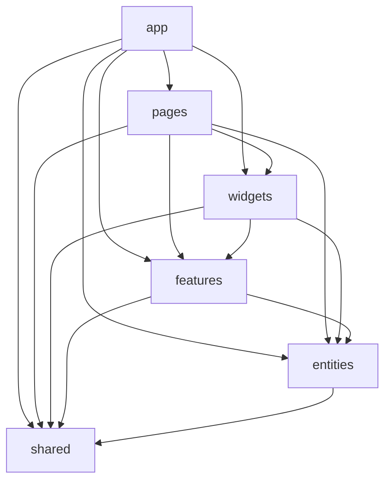

# Vue Lottery

## Окремі версії

| Версія | Гілка | Сайт | Локальна папка |
| --- | --- | --- | --- |
| 5 | `feature/routing` | https://benswors.github.io/vue-lottery-app/ | `Documents/vue-lottery-app` |
| 6 | `feature/fsd` | https://benswors.github.io/vue-lottery-app/lab-06/ | `Documents/vue-lottery-app-lab06` |

Гілка `feature/fsd` створена від завершеної `feature/routing`. Обидві папки можна відкрити у VS Code та запустити одночасно: 5-та використовує стандартний порт 5173, 6-та - 5176.

## Запуск

```bash
git clone -b feature/fsd https://github.com/Benswors/vue-lottery-app.git vue-lottery-app-lab06
cd vue-lottery-app-lab06
npm ci
cp .env.example .env
npm run dev
```

У PowerShell: `Copy-Item .env.example .env`.
У підготовленій локальній папці залежності та `.env` уже встановлені.
Адреса: `http://localhost:5176/vue-lottery-app/lab-06/`.
Тестовий вхід: `emilys` / `emilyspass`.

## Структура FSD

```text
src/
  app/                  ініціалізація, providers, router, layouts, styles
  pages/                home, about, users, user-details, user-create, user-edit, login, not-found
  widgets/              app-header, lottery, users-table
  features/             auth, user-form, participant-form, theme
  entities/             user, session, lottery, settings
  shared/               api, ui, lib, config
```

Кожен слайс відкриває Public API через `index.ts`. Усередині слайса використовуються відносні імпорти. `app` і `shared` складаються з сегментів без предметних слайсів.



`eslint-plugin-boundaries` перевіряє напрямки залежностей і доступ лише через `index.ts`, включно з type imports та dynamic imports. Слайси одного шару не імпортують один одного. `no-restricted-imports` додатково забороняє PrimeVue поза `shared/ui` та `app/providers/ui.ts`.

## Repository і Pinia

- `shared/api` містить HTTP-клієнт, generic-контракти та універсальний реєстр ServiceProvider. Бізнес-імпортів у цьому шарі немає.
- `entities/user/model` містить User/DTO і setup store. `entities/user/api` містить UserService і типізований ключ сервісу.
- `entities/session` містить AuthService, SessionUser та useSessionStore без залежності від сусіднього user-слайса.
- `app/providers/services.ts` реєструє конкретні сервіси. Сторінки та віджети звертаються до сторів.
- `useUsersStore` надає `users`, `total`, `isLoading`, `error`, `hasUsers`, `fetchUsers`, `fetchUser`, `createUser`, `updateUser`, `removeUser`.
- `useSessionStore` надає токени, поточного користувача, `isAuthenticated`, `setSession`, `clearSession`, `login`.
- Для деструктуризації state/getters у компонентах використовується `storeToRefs`.

DummyJSON імітує CRUD. Створені, змінені та видалені користувачі накладаються на дані API в store. Нові записи отримують від’ємні локальні id, оскільки DummyJSON повертає повторюваний id. Мутації Users живуть до reload. Початкова лотерея Home зберігає учасників у localStorage.

## PrimeVue

Імпортуються окремі Button, InputText, DataTable, Column, Dialog та Message. AppTable завантажується асинхронно. У `shared/ui` є AppButton, AppInput з помилкою валідації, AppTable, AppConfirmDialog, AppModal та AppNotifications. Форми інтегровані з VeeValidate + yup. Створення, оновлення, видалення й помилки входу супроводжуються сповіщеннями.

Aura налаштована з основним кольором `#3aafdc`. Перемикач теми змінює клас `dark` на кореневому елементі.

## Ручне збереження і persistedstate

`session.store.ts` вручну читає й записує `lottery:auth`. Це дозволяє перевіряти структуру збережених даних і явно очищати сесію після помилки refresh, але потребує окремих persist-викликів у діях.

`settings.store.ts` використовує `pinia-plugin-persistedstate` з `pick: ['theme']` і ключем `lottery:settings`. Плагін сам відновлює та зберігає тему. Це прибирає ручний код; натомість потрібно явно контролювати, які поля дозволено зберігати. До session plugin навмисно не застосовано, щоб порівняти обидві реалізації.

## Перевірки

```bash
npm run lint
npm run lint:fsd
npm run test:fsd
npm run type-check
npm run build
npm run test:e2e
```

`test:fsd` перевіряє сім навмисно заборонених імпортів та один дозволений. Браузерні тести перевіряють Home, тему, guard/redirect, пошук і сторінки у query, профіль, вкладене редагування, CRUD, сповіщення, Logout, 404. На Windows використовується Chrome; у CI встановлюється Chromium. Для повторюваності e2e API підмінено на рівні браузера. Окремо перевірено реальний DummyJSON, Bearer і один refresh для паралельних 401.

## Етапи виконання

1. Залежності Pinia persistence, PrimeVue і FSD-лінтер.
2. Шари FSD та Public API без зміни логіки.
3. Розподіл Repository між шарами.
4. Setup stores сесії, користувачів, лотереї й налаштувань.
5. UI-обгортки та тема.
6. Інтеграція сторів і обгорток у сторінках та віджетах.
7. Перевірка правил FSD, тестів і документації.

## Публікація

Workflow гілки `feature/fsd` перевіряє проєкт і публікує `dist` у підпапку `lab-06` гілки gh-pages з `keep_files: true`. Попередня публікація 5-ї залишається в корені. Якщо знову публікувати гілку 5-ї її старим workflow, його очищення gh-pages може прибрати підпапку 6-ї; повторний запуск workflow `feature/fsd` відновить її.

Автор: Семенко Володимир Анатолійович · [Benswors](https://github.com/Benswors)
